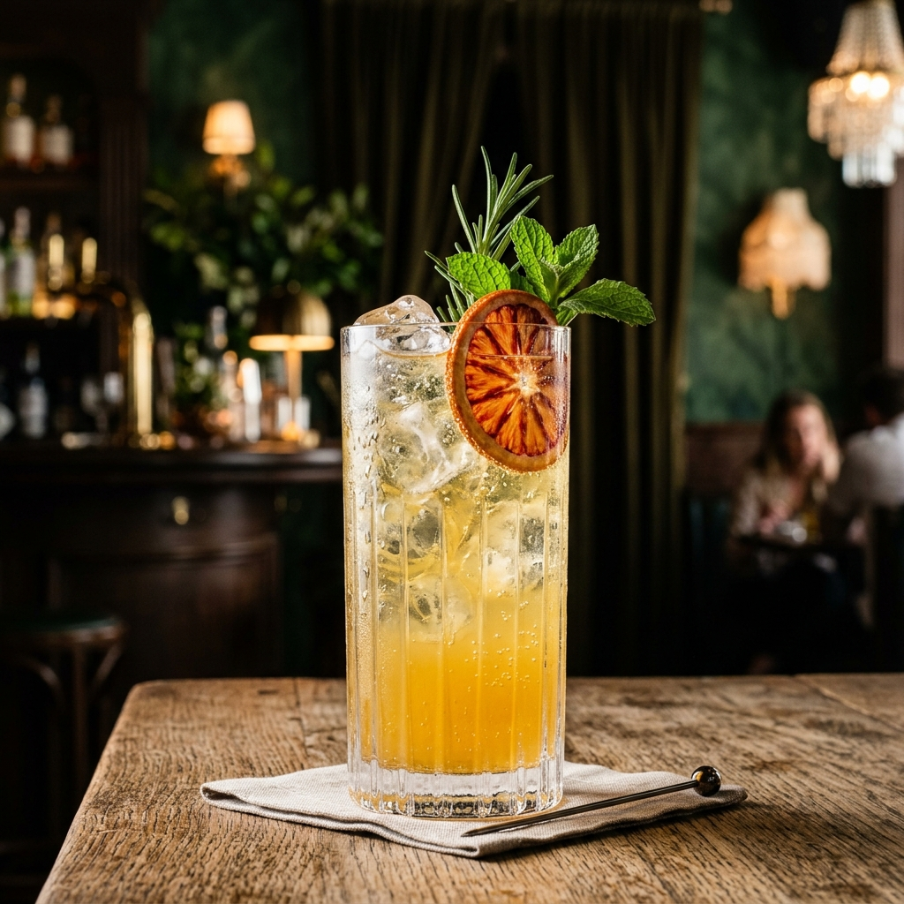

# PS8 — Mocktail Menu

A boutique non-alcoholic cocktail café web application built with **React**, **Vite**, and **React Router** for IIT Guwahati's PS8 assignment.

**Repository**: [https://github.com/iUjjwalRaj/ps8-mocktail-menu](https://github.com/iUjjwalRaj/ps8-mocktail-menu)  
**Live Deployment**: *[Add your deployed Vercel / Netlify URL here]*

---

## Overview

Mocktail Menu offers an artisanal, zero-proof beverage catalog powered by TheCocktailDB API. Designed with a boutique café aesthetic—featuring deep forest green, emerald, warm ivory, muted sage, and champagne gold accents—the application allows users to explore, search, and inspect recipes with complete measurements and preparation steps.

---

## Features

- **Editorial Home Page**: Ambient visual presentation with quick call-to-action navigation.
- **Curated Menu (`/drinks`)**: Fetches non-alcoholic drinks, rendering responsive cards with images and drink names.
- **Real-Time Controlled Search**: Instant client-side filtering by drink title.
- **Dynamic Recipe Details (`/drinks/:id`)**: Displays glass type, category, ingredients list with exact measurements, and step-by-step instructions.
- **Resilient States**: Handled loading indicators, empty search results, missing drink fallbacks, and network error notices.
- **404 Catch-All (`*`)**: Boutique not-found page with easy return navigation to Home.
- **Luxury Neon Nightclub Dark Mode**: Persistent theme toggle in the navbar switching between a warm botanical café (light mode) and an exclusive 2 AM neon cocktail lounge (dark mode) featuring electric violet, neon magenta, and cyan accents with drifting radial gradients.
- **Single Page Application (SPA) Routing**: Configured with `vercel.json` rewrite rules to ensure nested route refreshes load seamlessly.

---

## Application Routes

| Route | View | Description |
|---|---|---|
| `/` | **Home** | Boutique hero introduction with Explore Drinks CTA |
| `/drinks` | **Menu** | Non-alcoholic drinks gallery with controlled search filter |
| `/drinks/:id` | **Recipe Details** | Dynamic route displaying drink specifications, ingredients, and instructions |
| `*` | **Not Found** | Catch-all 404 page with return link |

---

## API Reference

The application interfaces directly with **TheCocktailDB**:

1. **Non-Alcoholic Drinks Filter**:
   ```
   https://www.thecocktaildb.com/api/json/v1/1/filter.php?a=Non_Alcoholic
   ```
   Retrieves non-alcoholic drink records containing `idDrink`, `strDrink`, and `strDrinkThumb`.

2. **Recipe Details Lookup**:
   ```
   https://www.thecocktaildb.com/api/json/v1/1/lookup.php?i=DRINK_ID
   ```
   Retrieves complete recipe information, including `strGlass`, `strCategory`, `strInstructions`, and paired ingredient/measurement fields (`strIngredient1`–`15`, `strMeasure1`–`15`).

---

## Screenshots

*Below are screenshots showcasing the application interface:*

### 1. Home Page


### 2. Drinks Collection
*Run the application locally to preview the interactive gallery and search filter.*

---

## Getting Started

### Prerequisites

- Node.js (v18+)
- npm

### Installation

1. Clone the repository:
   ```bash
   git clone https://github.com/iUjjwalRaj/ps8-mocktail-menu.git
   cd ps8-mocktail-menu
   ```

2. Install dependencies:
   ```bash
   npm install
   ```

3. Launch development server:
   ```bash
   npm run dev
   ```

4. Build for production:
   ```bash
   npm run build
   ```

---

## Deployment Configuration

For Single-Page Application (SPA) routing on Vercel, the repository includes `vercel.json`:
```json
{
  "rewrites": [
    {
      "source": "/(.*)",
      "destination": "/"
    }
  ]
}
```
This ensures refreshing dynamic routes like `/drinks/12562` resolves correctly to the index template without 404 errors.
